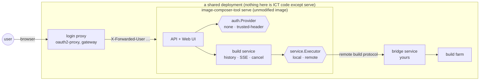
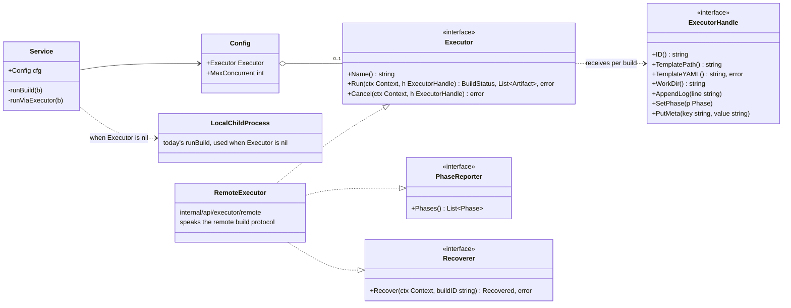
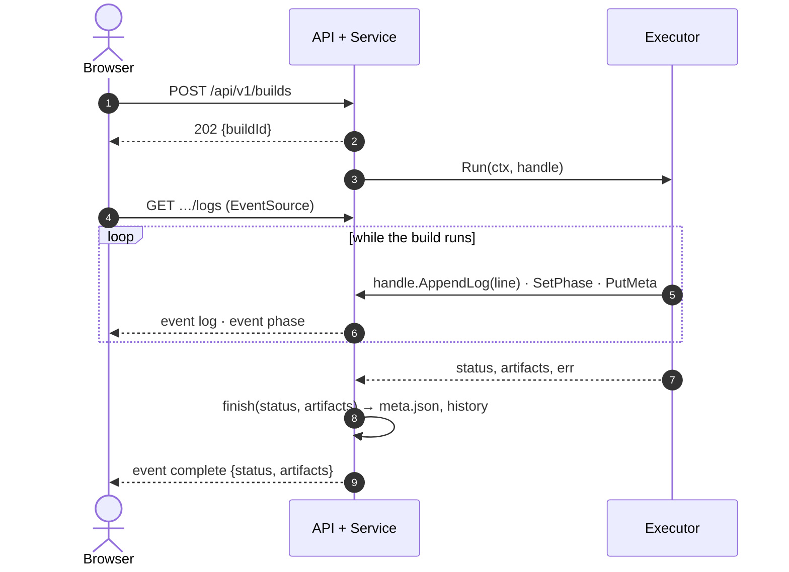
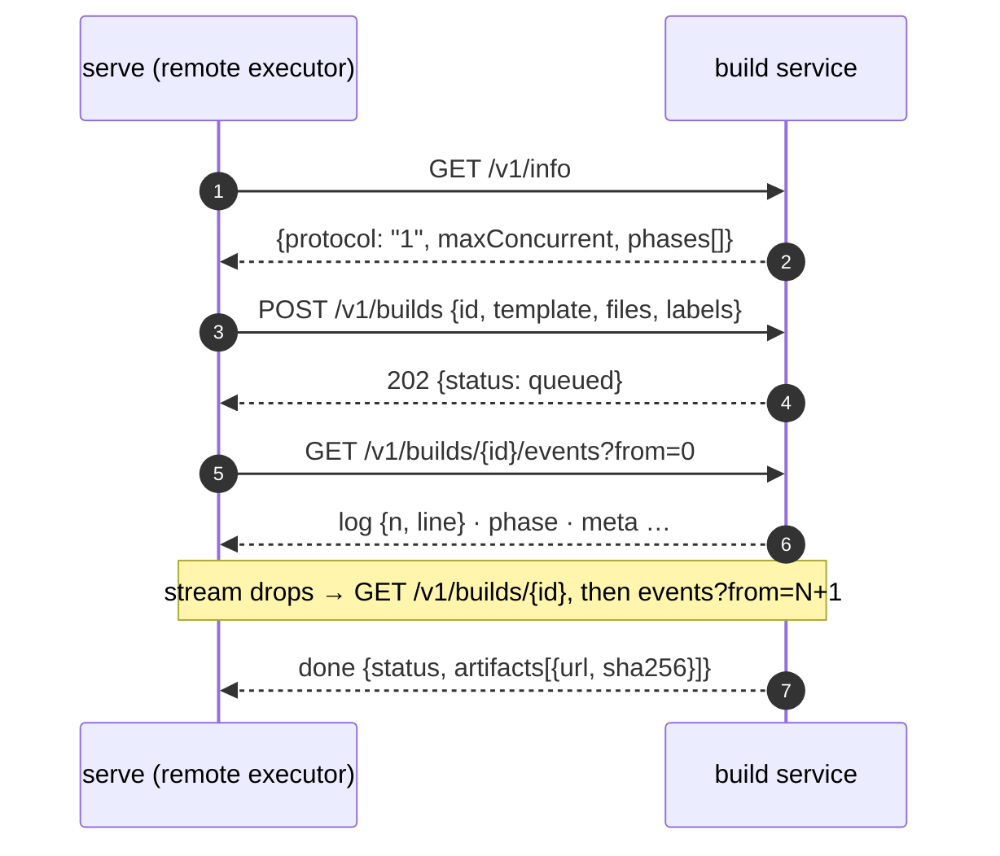
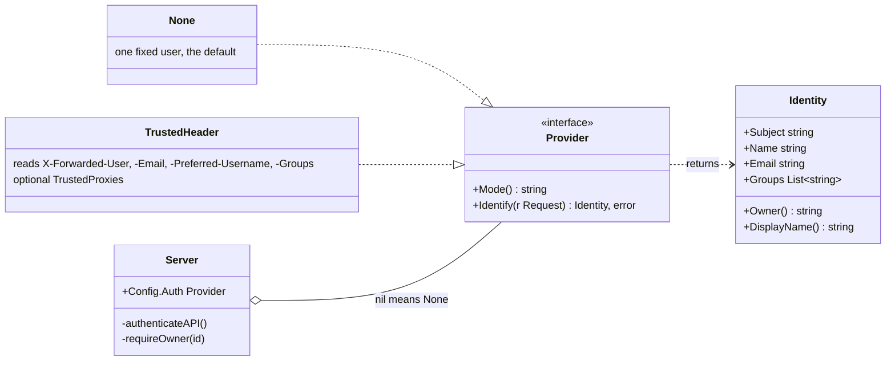
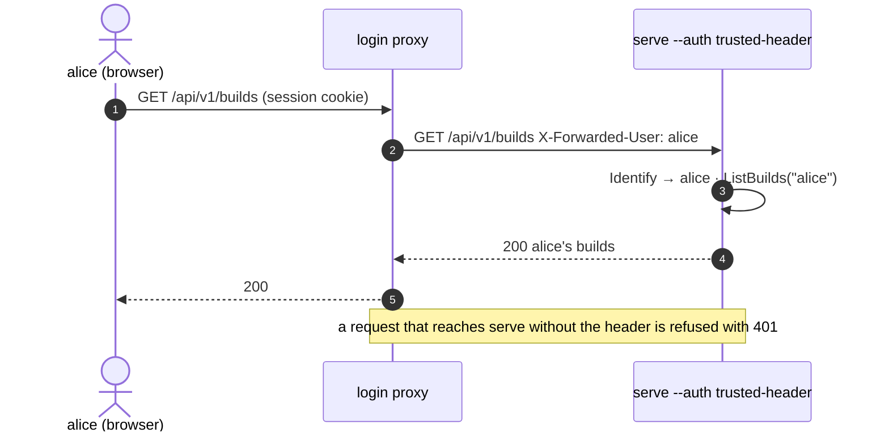

# ADR: Web UI Build Backends and Caller Identity as Extension Points

**Status**: Proposed
**Date**: 2026-11-11
**Authors**: ICT Team
**Technical Area**: Web UI / API

---

## Summary

`image-composer-tool serve` runs each build as a child process on its own host
and treats every caller as the same user. Both are right for a developer's
machine and wrong for a shared deployment, which needs builds to run on a farm
and users to be told apart. This ADR adds two extension points to `serve`, each
off by default and each without new dependencies:

- **A build backend seam.** `service.Executor` is the one interface between the
  build service and whatever runs a build. The local child process stays the
  default. A second implementation, `--executor remote`, speaks a small HTTP+SSE
  contract, the **remote build protocol**, to any service that runs ICT builds
  elsewhere. The API and the Web UI learn to show what a backend reports:
  phases, where the build runs, where the artifacts were published.
- **A caller identity seam.** `auth.Provider` says who is calling. `--auth none`
  keeps the single implicit user. `--auth trusted-header` takes the user from
  headers an authenticating reverse proxy sets, attributes builds to that user,
  and lists history per user. ICT performs no login itself.

A deployment that needs a farm and sign-in then runs this repository's image
unmodified behind a login proxy, with a small bridge service of its own that
implements the protocol for its farm.



The two hexagons are the extension points. On a developer's machine neither is
configured: the proxy and the bridge are absent, `auth.None` and the local
child process apply, and nothing observable changes.

### Reading guide

This ADR records the decision and its reasoning. The mechanics live with the
code and are documented, with class and sequence diagrams, in:

| Read this | When you want to |
|---|---|
| [Web UI build executors: the `Executor` seam](../user-guide/architecture/web-ui-build-executors.md) | implement or review a build backend |
| [Running builds on a farm: the remote build protocol](../user-guide/architecture/remote-build-protocol.md) | write the build service `serve` talks to, or point `serve` at one |
| [Who is calling: the caller identity seam](../user-guide/architecture/web-ui-caller-identity.md) | implement or review how callers are identified and builds owned |
| [Running the Web UI behind a login proxy](../user-guide/architecture/serve-behind-a-login-proxy.md) | deploy `serve` for a team |

---

## Context

Deploying the Web UI for a team has so far meant copying `internal/api` and
`web/` into another repository and patching them: `builds.go`, `service.go`,
`history.go`, `sse.go`, `handlers.go`, `BuildView.tsx` and `App.tsx` edited in
place to dispatch to a farm and to carry a user, and the Web UI's log stream
rewritten from `EventSource` to a hand-rolled fetch client because
`EventSource` cannot send a bearer token. Every upstream change to those files
then had to be re-merged by hand, and the copy's contract with its farm lived in
regular expressions over console text in three repositories.

The underlying needs are legitimate and generic: builds that run somewhere
else, and callers that are not all the same person. What was missing was a
place in ICT to plug them in.

---

## Decision

### 1. One seam for build backends



```go
type Executor interface {
    Name() string
    Run(ctx context.Context, h ExecutorHandle) (BuildStatus, []Artifact, error)
    Cancel(ctx context.Context, h ExecutorHandle) error
}
```

`Config.Executor == nil` keeps today's behaviour byte for byte; `runBuild`
spawns the ICT binary. With an executor set, `runViaExecutor` is the only code
that knows one exists. Everything after it — the log buffer, SSE, artifacts,
history, cancel bookkeeping, the Web UI — is shared.



The handle an executor receives (`ExecutorHandle`) can append log lines, report
a phase (`SetPhase`), record backend detail (`PutMeta`: worker, URL) and obtain
the template as one self-contained document (`TemplateYAML`: the Advanced tab's
delta with its `extends` chain folded in, since the worker has no access to this
host's templates directory). It cannot set the terminal status; only `Run`'s
return value does, so there is one path to completion.

Two optional capabilities an executor may declare: `PhaseReporter` (the ordered
phases its builds go through, so the Web UI draws its stepper from them) and
`Recoverer` (read a build back by id, so a restarted server picks up builds the
previous instance left running instead of recording them as interrupted).

Consequences in the service: the single build slot becomes a bounded set
(`Config.MaxConcurrent`, default 1, with the same shutdown-gate semantics);
shutdown leaves executor builds running, since they are not this host's
children; `Artifact` gains `URL` and `SHA256` for outputs published elsewhere.

### 2. The remote build protocol

Rather than a Go plug-in API, the one non-local executor ICT ships is a client
for an HTTP+SSE contract, `api/v1/remote-build-protocol.yaml`:

| Call | Purpose |
|---|---|
| `GET /v1/info` | name, protocol version, capacity, ordered phases |
| `POST /v1/builds` | submit `{id, template, files, labels}`; idempotent on ICT's id |
| `GET /v1/builds/{id}` | status, phase, backend detail, error, artifacts |
| `GET /v1/builds/{id}/events?from=N` | SSE: `log {n, line}`, `phase`, `meta`, `done` |
| `POST /v1/builds/{id}/cancel` | request cancellation |



A protocol was chosen over a public Go package because its surface is five
operations in one document, it can be implemented in any language, it lets ICT
and a deployment's bridge release independently, and it keeps every
farm-specific detail (job parameters, console scraping, artifact stores) out of
this repository. Within version `1` changes are additive only, and a client
refuses a server that reports another version.

The submission carries the auxiliary files a template references relative to
its templates directory (`additionalFiles[].local`, `initramfs.template`), so
the worker's image need not already contain them.

### 3. Identity from a trusted reverse proxy



```go
type Provider interface {
    Mode() string
    Identify(r *http.Request) (Identity, error)
}
```

`auth.None` returns one fixed user. `auth.TrustedHeader` reads the identity an
authenticating proxy put in the request headers (`X-Forwarded-User`, `-Email`,
`-Preferred-Username`, `-Groups` by default). Builds record an owner, history is
listed per owner, and every build route answers "not found" for another owner's
build so nobody can learn that it exists. `GET /api/v1/me` reports the caller;
`GET /api/v1/server` reports the executor and the auth mode so the Web UI can
adapt.



A proxy was chosen over sign-in code in ICT because a session cookie is sent by
`fetch`, `EventSource` and plain download links alike, so the Web UI needs no
token handling and the log stream keeps using `EventSource`; because login,
refresh and group claims are the proxy's job and ICT gains no dependency; and
because the pattern and its one rule are well understood. That rule — the proxy
must be the only way to reach the server — is enforced where it can be: a
request without the user header is refused, and `serve` refuses to start in
this mode on a non-loopback bind unless the proxy is named or the exposure is
accepted explicitly.

---

## Alternatives considered

- **A public Go extension package** that a deployment imports to compose its
  own `main` with its own executor, store and identity. Rejected for now: it
  would turn today's `internal/api` into a supported API surface, would still
  leave the Web UI's sign-in unsolved, and would tie a deployment's release to
  this module's.
- **Shipping farm adapters in ICT behind configuration.** Rejected: the
  adapters are specific to one deployment's farm and would add dependencies
  that local users cannot use.
- **Sign-in in the Web UI (OIDC/PKCE).** Rejected: it forces a token-carrying
  transport for the log stream, adds a browser auth dependency, and duplicates
  what an authenticating proxy already does.

---

## Consequences

- Local `serve` is unchanged: no new configuration, no new dependencies, the
  same single build slot and implicit user.
- A deployment that needs a farm or sign-in no longer copies or patches ICT; it
  runs the ICT image behind a proxy and implements the protocol for its farm.
- The Web UI renders executor-reported phases, URL artifacts, the worker a build
  ran on, the server's capacity and the signed-in user, all driven by what
  `GET /api/v1/server` and `GET /api/v1/me` report.
- ICT takes on a compatibility promise for the protocol document and for the
  identity headers' semantics.
- Build history remains the per-build `meta.json` on disk, now with an `owner`.
  A pluggable history store is not part of this decision; a deployment that
  needs one would add a `Store` seam in the same style.

## Delivery

The change is delivered as a stack of small pull requests on the integration
branch `feature/remote-executor`, each reviewable on its own and each leaving
the tree building, tested and lint-clean:

| # | Increment | What it adds |
|---|---|---|
| 1 | ADR | this document |
| 2 | Executor seam | `Executor`, `ExecutorHandle`, `PhaseReporter`, bounded slots, dispatch, tests; the executors guide |
| 3 | Recovery | `Recoverer`, start-up recovery of builds a previous instance left running |
| 4 | Protocol | `api/v1/remote-build-protocol.yaml`, wire types, SSE reader, reference service; the protocol guide |
| 5 | Remote client | `remote.Executor`: submit, follow with reconnect, cancel grace, recover |
| 6 | API data | `GET /server`, artifact `url`/`sha256`, `executor`/`meta`/`phase` on details, `maxConcurrent` |
| 7 | Identity package | `auth.Provider`, `None`, `TrustedHeader`, `Middleware`; the identity guide |
| 8 | Ownership | builds record an owner; per-user listing; `404` for others' builds; `GET /me` |
| 9 | `serve` flags | `--executor …`, `--auth …`; CLI reference, operator guides, security objectives, release notes |
| 10 | Web UI capacity | client types; Compose gated on `maxConcurrent` |
| 11 | Web UI rendering | phases stepper, remote artifacts, worker column, signed-in badge |

## Documentation

- `docs/user-guide/architecture/web-ui-build-executors.md`
- `docs/user-guide/architecture/remote-build-protocol.md`
- `docs/user-guide/architecture/web-ui-caller-identity.md`
- `docs/user-guide/architecture/serve-behind-a-login-proxy.md`
- `docs/user-guide/architecture/image-composer-tool-cli-specification.md` (serve flags)
- `docs/user-guide/architecture/image-composition-tool-security-objectives.md` (section 7)
