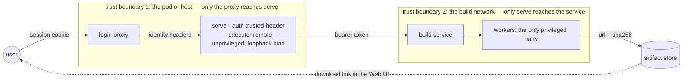

# ICT Tool Security Objectives

The ICT tool enables you to build minimal, verifiable, and secure
operating system images so you can reduce the attack surface of images and
simplify the adoption of modern boot mechanisms. The tool lets you encrypt
partitions, use dm-verity for root protection, and support Secure Boot.

## 1. Reduced Attack Surface

The ICT tool allows customization, enabling the inclusion of only
necessary kernel features and executables, reducing the overall attack surface
as defined by the user.

## 2. Secure Image Generation

To generate secure images, the tool optionally supports the following:

* Cryptographic signing of the boot chain (kernel, initial RAM disk, kernel
  command line) for Secure Boot, ensuring integrity and authenticity.
* Protect the root filesystem with dm-verity, making offline attacks
  more difficult.
* Generate a Software Bill of Materials (SBOM) for each image, providing
  transparency for its components in SPDX format which can be used with tools
  like `gradle` and `Maven`

## 3. Support for Modern Boot Mechanisms

The tool simplifies the adoption of Unified Kernel Image (UKI), a modern boot
mechanism, potentially improving edge node security by supporting secure boot.

## 4. Partition Customization

The ICT tool allows you to customize the partition layout,
including optionally encrypting root partitions, customizing partition sizes,
and adding partitions for security.

## 5. Web UI Package Search Verification

The web UI's package picker (`GET /packages/search`) verifies a repository's
`Release` metadata against a local GPG keyring when the repository catalog
supplies one that exists on disk. Every other repository family is searched
unverified because it has no genuine local trust anchor available today —
its signing key is fetched from a remote URL, is an rpm repository signed with
a same-origin key rather than a separately trusted keyring, or has no key
configured at all.

## 6. Running ICT in a Container

`docker compose up` runs the web UI in a container that is privileged and has
the host's `/dev` mounted, because building an OS image creates loop devices,
mounts filesystems, and chroots into them. The container is therefore
root-equivalent on the host, and the web UI has no authentication of its own.
The compose file publishes the port on `127.0.0.1` only, so only users of the
host itself can reach it. The container image does not store the proxy
settings of the host that built it; the proxy comes from the environment each
time the container starts.

`scripts/build-in-container.sh` runs command-line builds in the same
privileged container. It mounts the template's directory read-only and copies
only the build's outputs back to the host, owned by the invoking user.

## 7. Web UI Identity and Remote Builds

The web UI server performs no login of its own. With the default
`--auth none` every request is one implicit user, which is right for a
developer's own machine behind the loopback bind. For a shared deployment,
`--auth trusted-header` lets an authenticating reverse proxy establish the
identity and pass it in request headers; the server then attributes each build
to that user, lists history per user, and answers "not found" for another
user's build so that no one can learn that it exists. The design assumes the
proxy is the only path to the server: a request that carries no identity header
is refused rather than attributed to a default user, and the server refuses to
start in this mode on a non-loopback address unless `--auth-trusted-proxies`
names the proxy or the operator accepts the exposure explicitly with
`--auth-allow-remote-bind`. The SPA and its static assets are served without an
identity, because they are the code that the proxy's login protects and they
carry no data.

With `--executor remote` the server runs no build itself and needs no
privileges at all: it sends each self-contained template to a build service
over the [remote build protocol](remote-build-protocol.md) and relays the
service's log, phases and published artifact URLs. The service is expected to
be reachable only from the server (a bearer token, `ICT_EXECUTOR_TOKEN`, is
sent when configured) and to be the only party with privileged access to the
machines that build.

| Asset | Threat | Control |
|---|---|---|
| A user's identity | Forging `X-Forwarded-User` by reaching `serve` directly | Loopback bind beside the proxy, or `--auth-trusted-proxies`; `serve` refuses to start otherwise unless the operator opts in |
| Another user's build | Enumerating or reading it | Every per-build route answers `404` unless the caller owns the build |
| The build service | Submissions from anyone but `serve` | Private network plus a bearer token the service verifies |
| The template and auxiliary files in flight | Tampering | TLS on the proxy and on the service URL in production; the service is a thin bridge that never interprets the template |
| Published artifacts | Substitution | `sha256` reported with each artifact; verify after download |

See [Running the Web UI behind a login proxy](serve-behind-a-login-proxy.md)
for the deployment steps and a pre-flight checklist.

## 8. Deployed-System Provisioning

The provisioning settings applied during installation
(`systemConfig.users[].sshAuthorizedKeys`, `proxy`, `provisioning`,
`cloudInit`, `aptPolicy`) are designed so template input cannot escape the
image or corrupt generated configuration:

* Files the provisioning step generates (proxy settings, SSH keys, systemd
  units, cloud-init datasource, APT policy) are written into the image through
  an `os.Root` handle, so a symlink in the image (for example a home directory
  pointing at a host path) cannot redirect a write outside the image root.
  SSH key destinations (home, `.ssh`, `authorized_keys`) must not be symlinks
  at all. Script and cloud-init host files are placed by the general
  `additionalFiles` copy, which is not confined this way; like every other
  additional file, they trust the destination path inside the image.
* Script destinations that collide with generated files, or with each other,
  are rejected so a script's payload is never silently replaced.
* Host files referenced by these sections (scripts, cloud-init seed files, SSH
  key files) must be regular files, and symlinks are rejected when the template
  is loaded. This does not extend to the general `additionalFiles` entries,
  whose source files are checked with `os.Stat` and so follow symlinks.
* Proxy URLs, `noProxy`, script names and paths, and user `shell`/`home` are
  validated before they reach generated files or commands. Quotes, whitespace,
  line breaks, `..` traversal, and other values that could break out of a line
  or path are rejected. SSH key entries must each be a single line.
* SSH keys are installed with the ownership and modes sshd's `StrictModes`
  requires (`~/.ssh` `0700`, `authorized_keys` `0600`). Only public keys are
  accepted: each line must be an OpenSSH public key, so a private key file
  passed by mistake is rejected, and validation errors never echo key content.
* Proxy URLs with embedded credentials, query strings, or fragments are rejected, because the proxy is
  written to world-readable files and to the template carried on the ISO.
  Repository and package URLs in the composition manifest have credentials,
  query strings, and fragments removed.
* A user with sudo access (`sudo: true`, or membership of the `sudo` or `wheel`
  group) and no password is never left with an empty one. With
  SSH keys, the password is locked and the user gets passwordless sudo, limited
  to that user and written to `/etc/sudoers.d/90-ict-key-only-admins` (mode
  0440); without keys, the build stops before the account is created.
* The APT upgrade policy limits which repositories can replace installed
  packages. The distribution's security updates stay enabled unless the image
  is immutable.
* A `password` value that is already a crypt(3) hash is always set as a hash,
  so a pre-hashed password can never become the literal login password.
* The GitHub token for OEP Installer files in private repositories is read at
  build time from `ICT_OEP_INSTALLER_TOKEN`, or from a file that
  `ICT_OEP_INSTALLER_TOKEN_FILE` or the global configuration's
  `oep_installer.token_file` names. The file form keeps the token off command
  lines (the Web UI's `serve --sudo` passes only a path) and out of
  `docker inspect`; ICT warns when other users can read the file. The token is
  sent only to GitHub hosts, is never logged, and is not written to the image
  or to the template carried on the ISO.
* The template carried on the ISO references provisioning inputs through
  their on-ISO copies; build-host paths of scripts, cloud-init files, and SSH
  key files are not included.
* No command was added to the shell allowlist for these features.
