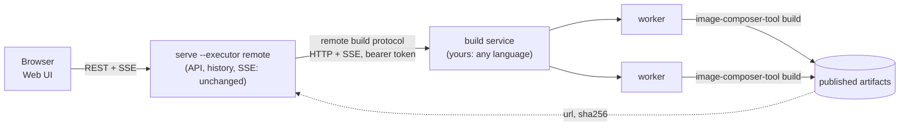
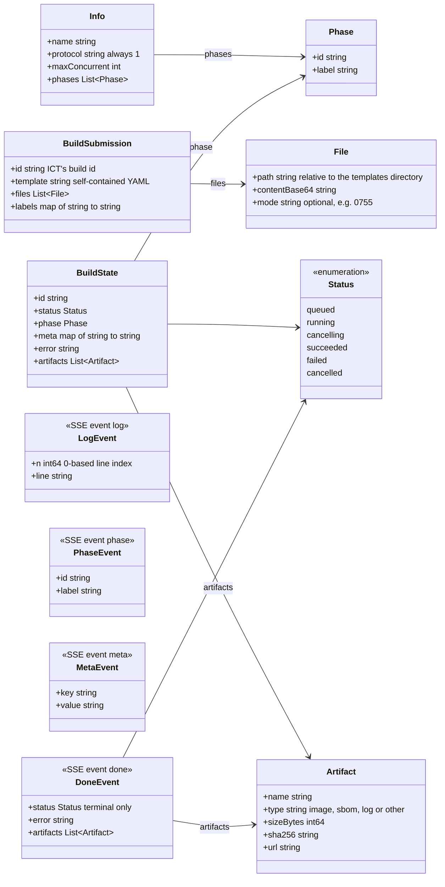
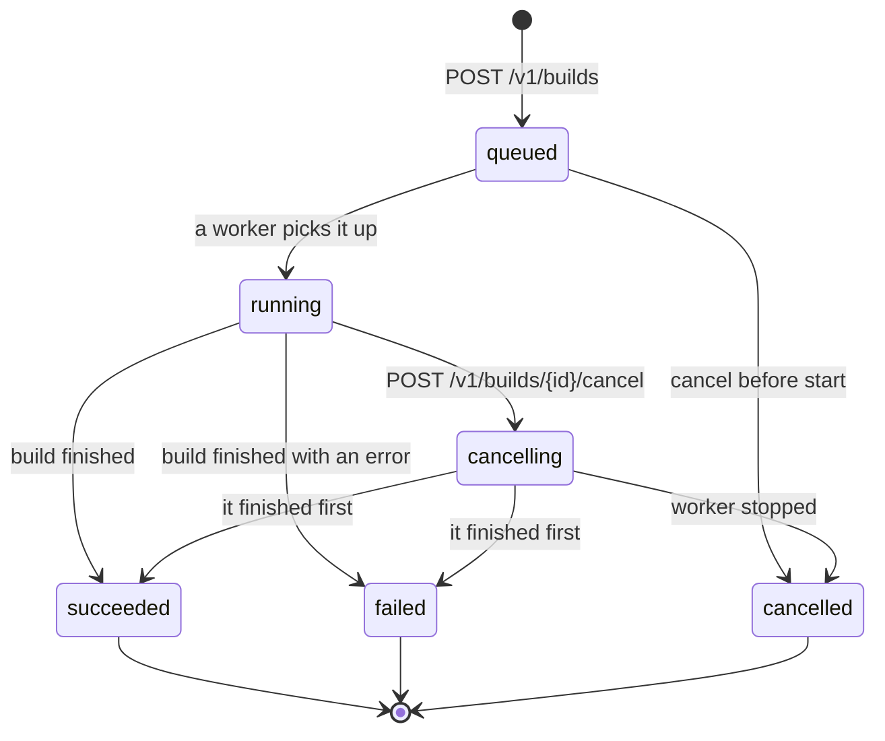
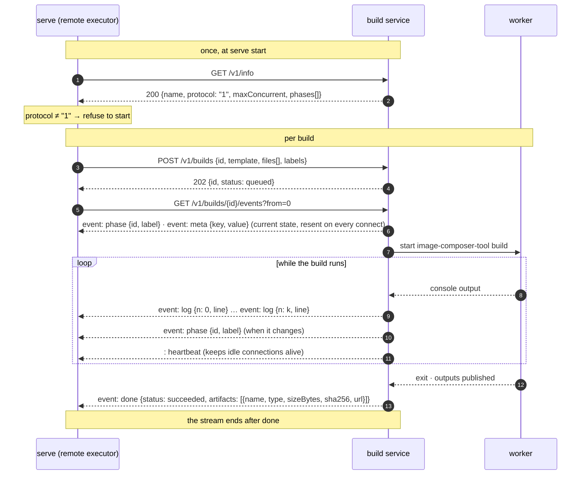
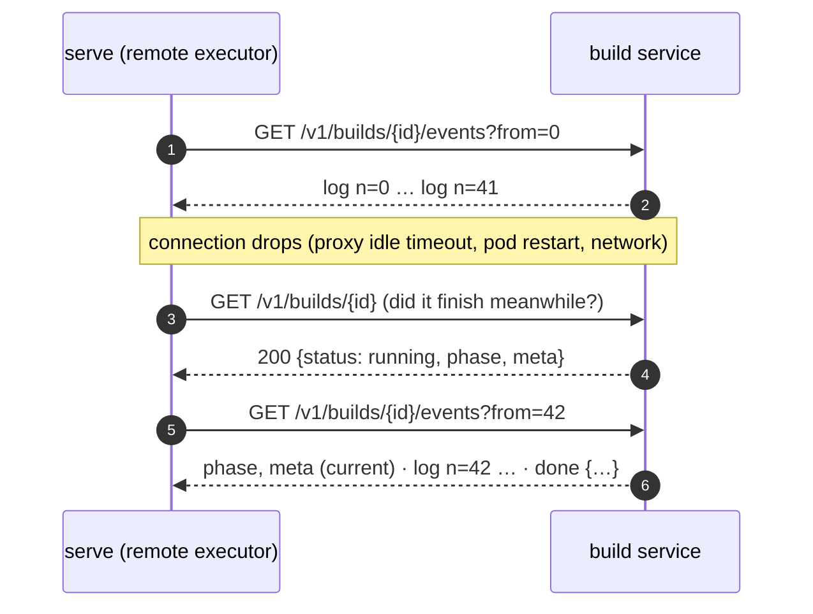
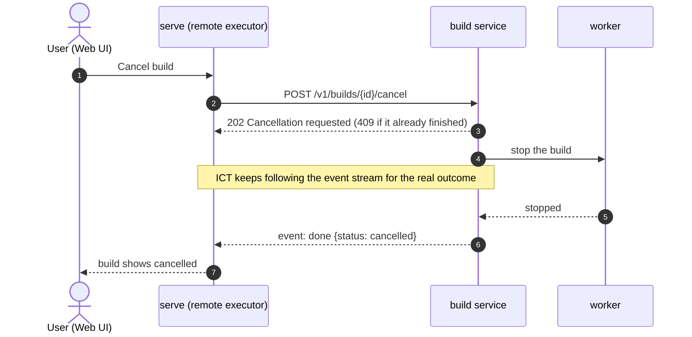
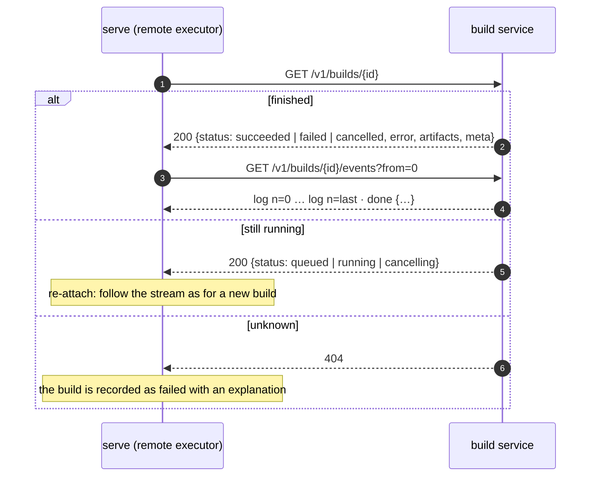

# Running builds on a farm: the remote build protocol

**Who this is for.**

- a **developer** writing the **build service** that `serve` talks to, or
  reviewing ICT's client for it — read on from [The protocol in one
  table](#the-protocol-in-one-table).

**In one sentence.** The remote build protocol is a small HTTP + Server-Sent
Events contract: `serve` submits a self-contained template, follows a resumable
event stream of log lines, phases and worker detail, can cancel, and can read a
finished build back. Any program in any language that implements it is a build
service; the Web UI, the API and build history behave the same whichever
backend runs the build.

**Normative document:** [`api/v1/remote-build-protocol.yaml`](../../../api/v1/remote-build-protocol.yaml)
(OpenAPI 3.0). This page explains it; where they differ, the YAML wins.

The build service is a **thin bridge**: it starts `image-composer-tool build`
somewhere, relays what happens, and publishes the outputs. Template semantics
stay with ICT on the worker; the service never interprets the template.

## The protocol in one table

| Call | Purpose |
|---|---|
| `GET /v1/info` | `{name, protocol: "1", maxConcurrent, phases[]}` — capabilities ICT sizes itself from |
| `POST /v1/builds` | submit `{id, template, files[], labels}`; idempotent on `id`; `202 {id, status, …}` |
| `GET /v1/builds/{id}` | `{id, status, phase, meta, error, artifacts}` — the build's current state |
| `GET /v1/builds/{id}/events?from=N` | SSE: `log {n, line}`, `phase {id, label}`, `meta {key, value}`, `done {status, error, artifacts}` |
| `POST /v1/builds/{id}/cancel` | `202`; the stream then ends with `done {status: cancelled}` |

Statuses: `queued`, `running`, `cancelling`, `succeeded`, `failed`, `cancelled`.
Artifacts: `{name, type ∈ image|sbom|log|other, sizeBytes, sha256, url}`; the Web
UI links to `url`.

## Resources and events

Every resource is keyed by the **build id ICT chose**. That is what lets a
restarted `serve` ask about a build it started earlier, and what makes
`POST /v1/builds` idempotent: a second submission with the same `id` returns
the existing build and starts nothing.

## Build lifecycle

`succeeded`, `failed` and `cancelled` are **terminal**: the event stream ends
with a `done` event carrying that status, and `GET /v1/builds/{id}` keeps
answering it for as long as the service remembers the build. A cancel that
arrives after the build finished is answered `409`; the client treats that as
"already done" and reads the real outcome.

## Sequence: a build from submission to done

## Sequence: resuming a broken stream

The log is numbered so that a client that reconnects **neither loses nor
repeats** a line. `from` is the index of the first line the client still
needs; `phase` and `meta` are resent in full on every connect, since they
describe the current state rather than a position in the log.

## Sequence: cancelling

## Sequence: a finished build read back

A client that lost track of a build — typically `serve` after a restart — reads
its state and, for the log, replays the stream, which a finished build ends
immediately with `done`.

## What the service receives

`POST /v1/builds` carries ICT's build id, the **complete** template (the
Advanced tab's delta and every `extends` already folded in; the worker's ICT
applies only its OS defaults), and the auxiliary files the template references
relative to the templates directory — `additionalFiles[].local` and
`initramfs.template` — so the worker does not need to carry them in its image.
`labels` names the template's image and whatever the deployment configured
(an environment name, say).

## Rules a service must follow

- Key everything by ICT's `id`, and make `POST /v1/builds` idempotent on it.
- Number log lines from 0 and honour `from`, so a reconnecting client neither
  loses nor repeats lines. Resend `phase` and `meta` on every connect.
- End a finished build's stream with `done` immediately on connect.
- Answer `429` when you have no free capacity; ICT does not retry, it reports
  the build as failed to start. Report an honest `maxConcurrent` in `/v1/info`
  and ICT will not ask for more than that.
- Send a heartbeat line (`:`) on an idle stream so proxies do not close it.
- Within protocol `1`, add fields but never remove or rename them.

## Writing a build service

The client's tests run against an in-memory reference service
(`internal/api/executor/remote/fake_service_test.go`) that is a faithful,
minimal implementation to copy from, and `TestReferenceServiceFollowsTheProtocol`
pins the behaviours above. A service in any language is fine: the contract is
HTTP and JSON. Keep it thin — it should start a build, relay what happens and
publish the outputs; template semantics belong to ICT on the worker.

A checklist for a first implementation:

1. `GET /v1/info` returns `protocol: "1"`, a name, an honest `maxConcurrent`,
   and your phases in order (or none).
2. `POST /v1/builds` writes the template and `files` where the worker will run,
   starts the build, and returns `202` with the state; the same `id` again
   returns the same build.
3. Capture the worker's console as numbered lines; serve them as `log` events
   from `from` onwards; emit `phase` when your pipeline moves on and `meta` for
   worker name and job URL; end with `done`.
4. `POST …/cancel` stops the job and the stream ends with `done {cancelled}`.
5. Keep finished builds, their artifacts' URLs and their logs for as long as
   you want them visible in the Web UI's history.
