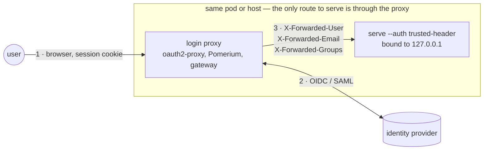
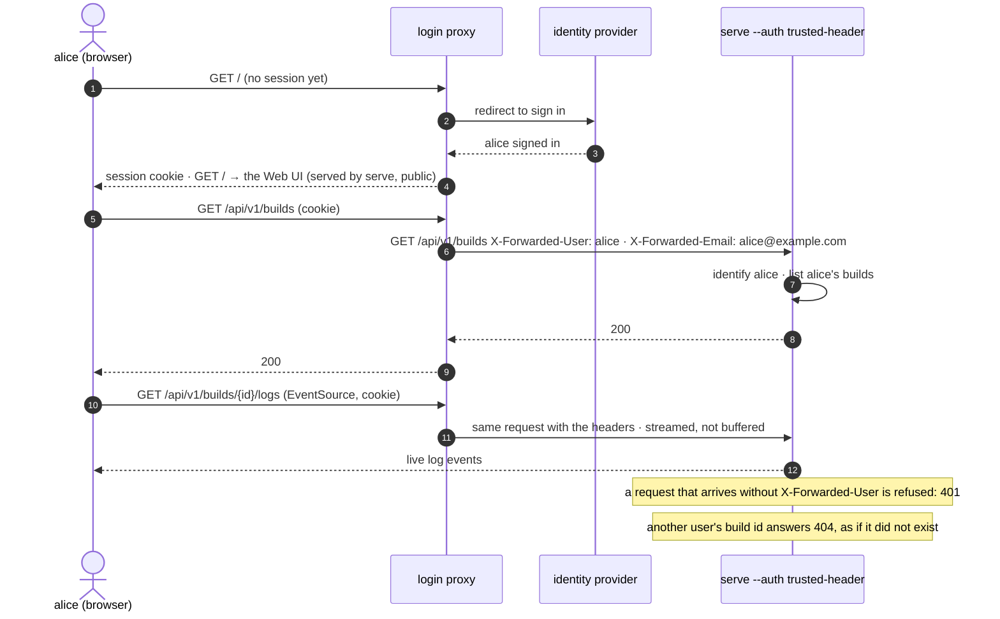
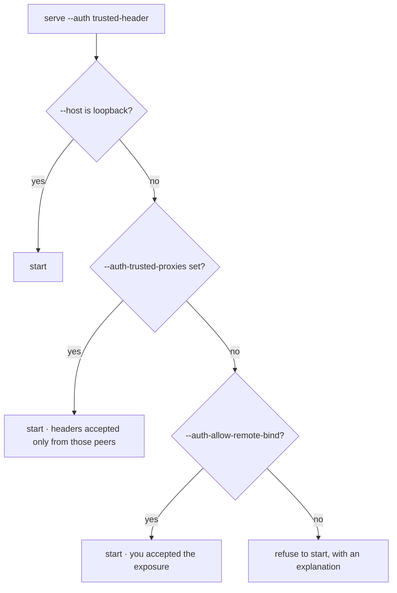

# Running the Web UI behind a login proxy

**Who this is for.** Operators deploying `image-composer-tool serve` for a
team, where users must sign in and each user should see their own builds.
Developers who want to know how identity flows through the code should read
[Who is calling: the caller identity seam](./web-ui-caller-identity.md).

`image-composer-tool serve` performs no sign-in of its own. On a developer's
machine that is right: it binds to `127.0.0.1`, and whoever can reach it is its
one user. A shared deployment puts an **authenticating reverse proxy** in front
of it — oauth2-proxy, Pomerium, an enterprise gateway — and tells `serve` to
trust the identity headers that proxy sets:



With `--auth trusted-header`:

- every `/api/` request must carry the user header (default `X-Forwarded-User`);
  one without it is refused with 401, never attributed to a default user;
- each build records the user as its owner, `GET /api/v1/builds` lists only the
  caller's builds, and another user's build answers 404 on every route;
- `GET /api/v1/me` reports the caller (`owner`, `displayName`, `email`,
  `groups`), and the Web UI greets them in its header;
- the SPA and its assets stay public to `serve`; the proxy decides who may load
  them at all.

Because the browser holds a session cookie rather than a token, every kind of
request works unchanged: `fetch`, `EventSource` for the live build log, and plain
download links.

## What a request looks like end to end



## Flags

| Flag (env) | Default | Meaning |
|---|---|---|
| `--auth` (`ICT_AUTH`) | `none` | `none` or `trusted-header` |
| `--default-user` (`ICT_DEFAULT_USER`) | `local` | The one user with `--auth none` |
| `--auth-user-header` | `X-Forwarded-User` | Required; its value is the owner key |
| `--auth-name-header` | `X-Forwarded-Preferred-Username` | Display name |
| `--auth-email-header` | `X-Forwarded-Email` | Email |
| `--auth-groups-header` | `X-Forwarded-Groups` | Comma-separated groups |
| `--auth-trusted-proxies` (`ICT_AUTH_TRUSTED_PROXIES`) | | Addresses/CIDRs the headers are accepted from |
| `--auth-allow-remote-bind` | off | Permit a non-loopback bind without trusted proxies |

## The one rule: the proxy must be the only way in

Anyone who can send a request straight to `serve` can set the header and claim
any identity. Make that impossible:

- bind `serve` to loopback and run the proxy in the same pod or on the same host
  (a sidecar), so only the proxy can reach the port; or
- set `--auth-trusted-proxies` to the proxy's address, and keep a network policy
  that lets nothing else reach `serve`.

`serve` refuses to start with `--auth trusted-header` on a non-loopback address
unless one of those is in place (`--auth-trusted-proxies`), or you accept the
risk explicitly with `--auth-allow-remote-bind`.



## Example: oauth2-proxy sidecar

```yaml
# oauth2-proxy arguments (abridged); the provider block is specific to your IdP
- --http-address=0.0.0.0:4180
- --upstream=http://127.0.0.1:8080
- --set-xauthrequest=true          # X-Auth-Request-* headers to the upstream
- --pass-user-headers=true         # X-Forwarded-User / -Email / -Preferred-Username / -Groups
- --cookie-secure=true
```

```bash
image-composer-tool serve --host 127.0.0.1 --port 8080 --auth trusted-header
```

For SSE, the proxy must stream responses without buffering and allow long-lived
requests; oauth2-proxy and nginx both do with `proxy_buffering off` and a
generous read timeout.

## Checklist before you go live

1. `curl -s http://<serve host>:8080/api/v1/me` from **outside** the pod or
   host must fail to connect, or answer `401`; if it answers `200`, something
   other than the proxy can reach `serve`.
2. Through the proxy, signed in, `GET /api/v1/me` returns your identity and
   `GET /api/v1/server` reports `"auth": {"mode": "trusted-header"}`.
3. Two users each see only their own builds in the Web UI's history.
4. The live log keeps streaming for longer than the proxy's idle timeout.
