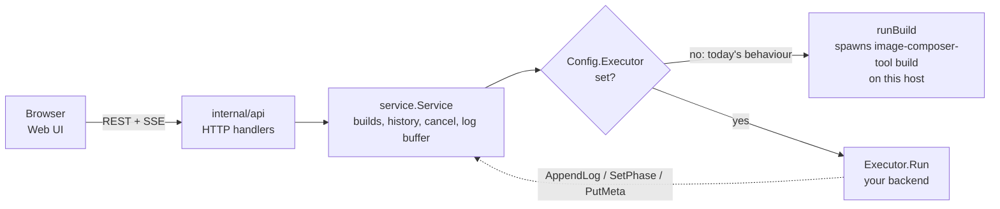
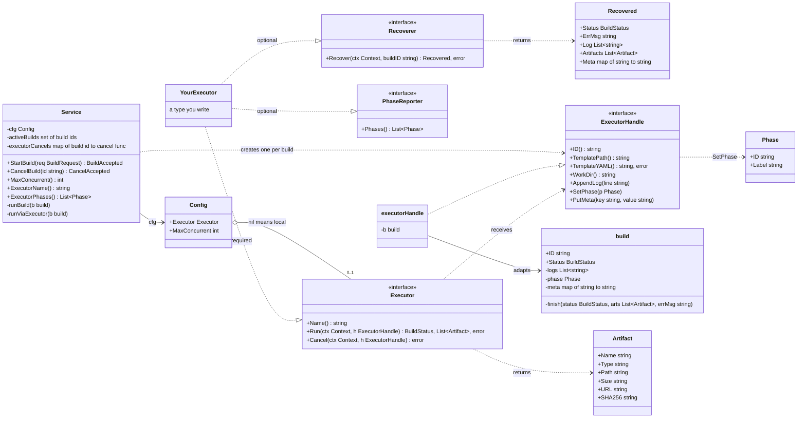
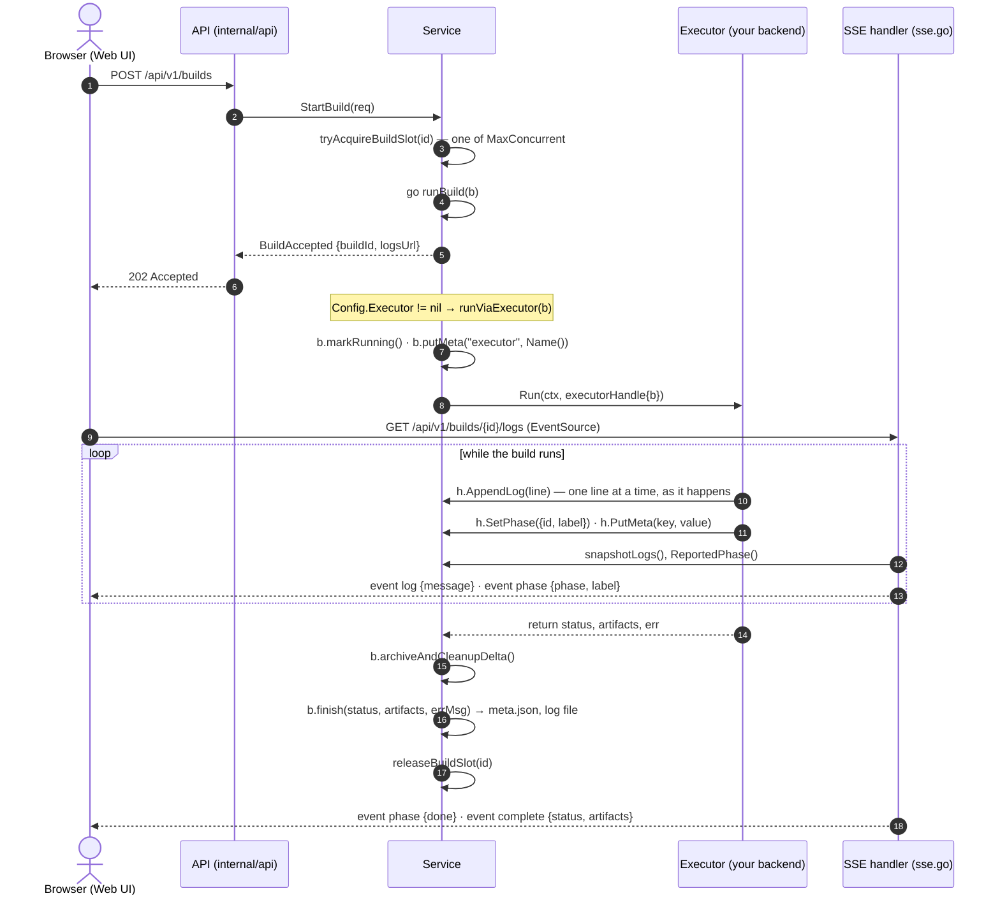
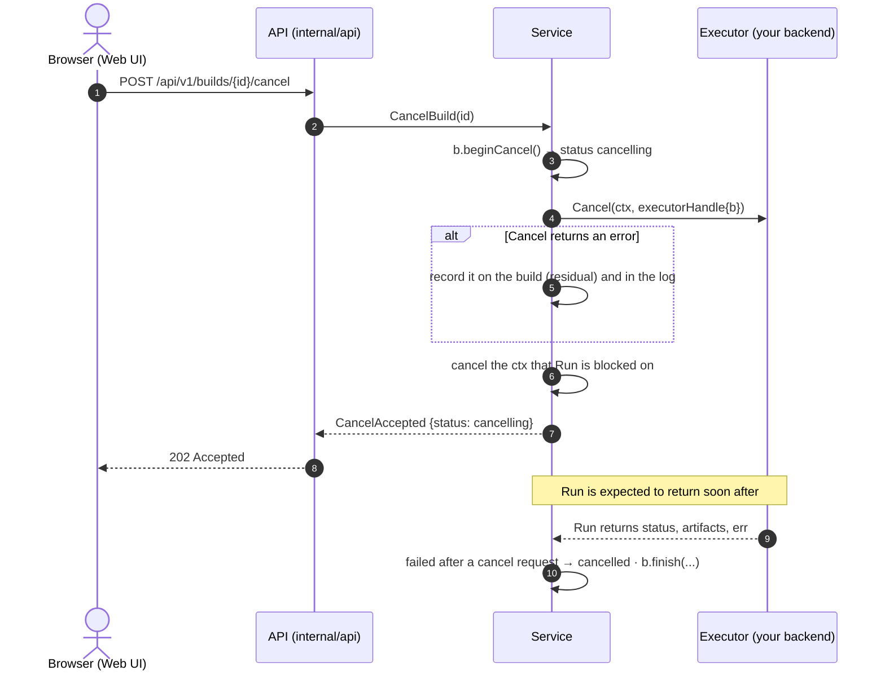
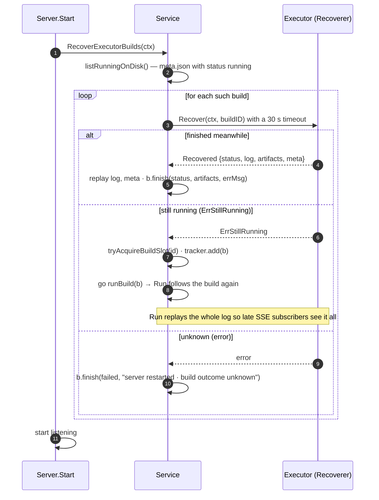

# Web UI build executors: the `Executor` seam

**Who this is for.** Contributors who want `image-composer-tool serve` to run
builds somewhere other than its own host, reviewers of such a change, and
anyone reading `internal/api/service` who wants to know where a build backend
plugs in.

**In one sentence.** `service.Executor` is the single interface between the Web
UI build service and whatever runs a build. Everything on either side of it —
the HTTP API, the live log stream, build history, cancellation and the Web UI —
is shared by every backend, so a new backend is one type that implements three
methods, not a fork of the service.

**Where the code is.**

| What | Where |
|---|---|
| The seam: `Executor`, `PhaseReporter`, `ExecutorHandle`, `Phase` | `internal/api/service/executor.go` |
| The dispatch: `runViaExecutor`, cancel bookkeeping | `internal/api/service/executor.go` |
| The default (no executor): `runBuild` spawns the ICT binary | `internal/api/service/builds.go` |
| Capacity: `Config.MaxConcurrent`, the slot set | `internal/api/service/service.go` |
| A fake executor and the seam's tests | `internal/api/service/executor_test.go` |

## Where the seam sits

`Config.Executor == nil` keeps today's behaviour byte for byte. With an
executor set, `runViaExecutor` is the only code that knows one exists.

## The seam as a class diagram

How to read it:

- **`Executor`** is what you implement. `Run` drives one build to completion
  and returns how it ended; `Cancel` asks it to stop. `Name` is shown in the
  startup banner and in build details.
- **`ExecutorHandle`** is the executor's view of one build: read the template,
  publish log lines, report a phase, record backend detail. It deliberately
  has **no** way to set the build's terminal status; only `Run`'s return value
  does, so there is exactly one path to completion.
- **`PhaseReporter`** is optional. If your executor knows the ordered phases its
  builds go through, the Web UI draws its stepper from them instead of from the
  fixed local phases.
- **`Recoverer`** is optional. If your executor can read a build back by id, a
  restarted server picks up builds the previous instance left running instead
  of recording them as interrupted (see [Recovering builds after a
  restart](#recovering-builds-after-a-restart)).
- **`Config.Executor`** is how `serve` plugs an executor in; **`MaxConcurrent`**
  is how many builds the service lets run at once (default 1).

## A build through an executor

Points that matter when you implement `Run`:

1. **Stream the log.** Call `h.AppendLog` as lines arrive. The SSE handler
   publishes whatever is in the buffer on each tick; a `Run` that appends
   everything at the end looks hung for the life of the build.
2. **A build that ran and failed is not an error.** Return `StatusFailed` with a
   `nil` error so its log and partial artifacts are kept. Return a non-nil
   error only when the build could not be run at all (the service records it as
   failed with your message).
3. **Return `StatusCancelled`** when the build stopped because `Cancel` was
   called. If you return `StatusFailed` after a cancel was requested, the
   service records `cancelled` anyway: the user's intent wins over the symptom.
4. **Artifacts** may live on this host (`Path`, under `h.WorkDir()`) or
   elsewhere (`URL`, with `SHA256`). Both are recorded in `meta.json`.

## Cancelling an executor build

`Cancel` may return before the build has actually stopped. The service cancels
the context it passed to `Run` as well, so an executor that only watches the
context still stops. There is no watchdog on this path: `runViaExecutor` records
the terminal state when `Run` returns, so `Run` **must** return once the build
has stopped.
ICT's remote executor, for instance, keeps following the build for a bounded
grace period after a cancel so the real outcome is recorded rather than assumed.

## Phases, metadata and artifacts: how they reach the UI

| You call | The service stores it as | Where it surfaces |
|---|---|---|
| `h.AppendLog(line)` | the build's log buffer and, at the end, `build.log` | SSE `log` events; `GET /api/v1/builds/{id}/logfile` |
| `h.SetPhase(Phase{ID, Label})` | the build's reported phase (`ReportedPhase()`) | SSE `phase` events (`phase`, `label`) |
| `h.PutMeta(key, value)` | `meta.json` → `meta` map (`worker`, `url`, …) | `BuildDetails.Meta`, `HistoryItem.Meta` in the service |
| `Phases()` (PhaseReporter) | nothing; read on demand | `Service.ExecutorPhases()` |
| `Run`'s return value | status, artifacts, error in `meta.json` | SSE `complete`/`error`; details; history; artifact list |

The SSE handler prefers an executor-reported phase over the log-derived one;
when an executor never calls `SetPhase`, the local phase detection runs over the
log lines exactly as before.

## Capacity and shutdown

- The single build slot is a **bounded set** of `Config.MaxConcurrent` slots
  (default 1). `StartBuild` answers `409` once they are all held.
- The local executor must keep `MaxConcurrent == 1`: local builds share this
  host's mounts and loop devices.
- **Shutdown leaves executor builds running.** They are not this host's child
  processes, so `CancelInFlightBuilds` returns early when an executor is set.
  A restarted server recovers them (next section).

## Rules for an `Executor` implementation

- `Name()` is a short, stable, human-readable name (`"local"`, `"farm-1"`).
- `Run` blocks for the life of the build, honours `ctx`, streams the log, and
  returns exactly once with a terminal status.
- `Cancel` is idempotent and safe to call for a build that has already finished.
- `Run` and `Cancel` may be called concurrently for different builds; the
  service holds no lock while calling either.
- Use `network.NewSecureHTTPClient()` rather than `http.DefaultClient` for any
  HTTP your executor does (see the coding style guide).
- Implement `PhaseReporter` when your backend has well-defined phases; keep the
  `ID`s stable, the `Label`s human.
- Implement `Recoverer` when your backend can be asked about a build by the id
  the service gave it; it is what makes a `serve` restart harmless.

## Recovering builds after a restart

A build record whose status is still `running` when `serve` starts means the
previous instance went away mid-build. For the local executor that build is
lost (its child process died with the server). For an executor that implements
`Recoverer`, the service asks what became of each such build and brings the
record to its real state, once, before the server starts serving.

A build that is still running is **re-adopted**: it takes a slot and `Run` is
called for it exactly as for a new build, so cancel, SSE and history work for
it unchanged. If no slot is free, the build is left as it is and a warning is
logged; it will be recovered on the next start.

## The executor ICT ships

`internal/api/executor/remote` implements `Executor`, `PhaseReporter` and
`Recoverer` over the [remote build protocol](./remote-build-protocol.md): an
HTTP+SSE contract that any build service, in any language, can implement. It is
the executor behind a build farm.
Read it as a worked example of this seam, and read the protocol document for
how its `Run`, `Cancel` and `Recover` map onto the five calls a build service
exposes.

## Testing an executor

`internal/api/service/executor_test.go` has a `fakeExecutor` that scripts log
lines, phases, outcome and cancel behaviour, and tests that pin the seam's
contract: a build runs and records its outcome, `MaxConcurrent` is honoured,
cancel reaches the executor and the build ends `cancelled`, a `Run` error fails
the build with its message, the template arrives self-contained, and shutdown
leaves executor builds running. Start from it when you test your own executor;
the same tests, pointed at your type, are a conformance suite.
