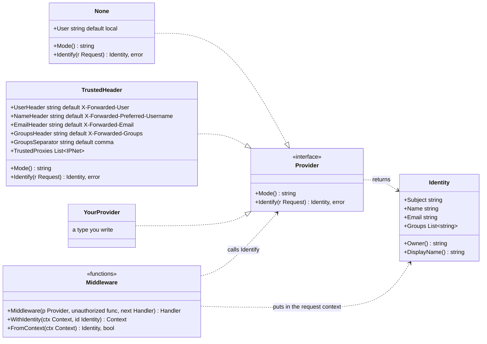
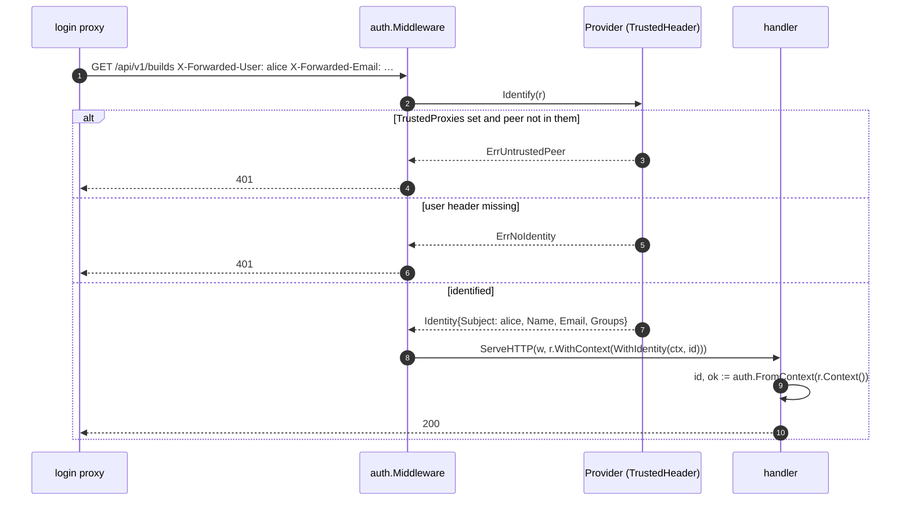
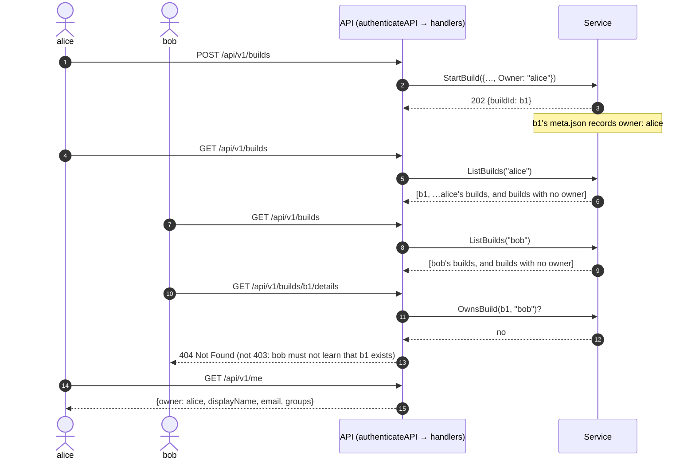

# Who is calling: the caller identity seam

**Who this is for.** Contributors and reviewers working on how the Web UI
server tells its users apart, and anyone adding a new way of identifying
callers. Operators who want to put `serve` behind a login proxy should read
[Running the Web UI behind a login proxy](./serve-behind-a-login-proxy.md); this
page is about the code underneath.

**In one sentence.** `auth.Provider` answers one question for each request —
*who is calling?* — and ICT does nothing else about sign-in: no login page, no
sessions, no tokens. A deployment that needs sign-in puts an authenticating
reverse proxy in front of `serve`, and the `TrustedHeader` provider reads the
identity that proxy asserts in request headers.

**Where the code is.**

| What | Where |
|---|---|
| `Identity`, `Provider`, `None`, `TrustedHeader`, `Middleware` | `internal/api/auth/auth.go` |
| Tests, including a table of header combinations | `internal/api/auth/auth_test.go` |
| Wiring into the API: `authenticateAPI`, `ownerOf`, `requireOwner`, `GET /me` | `internal/api/identity.go` |
| Build ownership: `BuildRequest.Owner`, `build.Owner`, `ListBuilds(caller)`, `OwnsBuild` | `internal/api/service/builds.go`, `history.go` |

## The seam as a class diagram

How to read it:

- **`Provider`** is the seam. `Identify` either returns an `Identity` or an
  error; an error means the request carries no acceptable identity and is
  refused with `401`. `Mode` is a short name the server reports so clients can
  adapt (`"none"` or `"trusted-header"`).
- **`Identity.Subject`** is the stable key a user is known by (a user name, an
  object id). `Owner()` returns it; builds are filed under it. `Name`, `Email`
  and `Groups` are for display and future policy; `DisplayName()` picks the
  friendliest one available.
- **`None`** attributes every request to one fixed user. It is the default and
  is today's behaviour: `serve` on a developer's own machine.
- **`TrustedHeader`** trusts what an authenticating reverse proxy wrote into the
  headers. A request without the user header is **refused**, never attributed
  to a default user. `TrustedProxies`, when set, additionally refuses requests
  whose peer address is not one of the proxy's.
- **`Middleware`** runs `Identify` for every request it wraps and attaches the
  result to the request context, where handlers read it with `FromContext`.

## Sequence: identifying one request

With `None` the middle branch never happens: `Identify` always returns the one
configured user, so every request is identified and nothing is refused.

## The headers `TrustedHeader` reads

| Header (default name) | Required | Becomes |
|---|---|---|
| `X-Forwarded-User` | yes | `Identity.Subject` (the owner key) |
| `X-Forwarded-Preferred-Username` | no | `Identity.Name` |
| `X-Forwarded-Email` | no | `Identity.Email` |
| `X-Forwarded-Groups` | no | `Identity.Groups`, split on `,` |

These are the names oauth2-proxy and most gateways use. All four are
configurable; the user header is the only one that must be present.

**The one rule.** Whoever can send a request straight to `serve` can set these
headers and be anyone. `TrustedHeader` is therefore only safe when the proxy is
the only way to reach the server: bind `serve` to loopback beside the proxy, or
set `TrustedProxies` to the proxy's addresses and keep a network policy that
lets nothing else in.
`serve` checks this at start; see [Running the Web UI behind a login
proxy](./serve-behind-a-login-proxy.md).

## What the API does with the identity

The pieces, and where each lives:

- **Only `/api/` is authenticated.** `authenticateAPI` wraps the API routes in
  `auth.Middleware`; the SPA and its static assets are served without an
  identity because they are the code a login proxy protects and carry no data.
- **Every build records its owner**, in memory and in `meta.json`
  (`"owner": "alice"`), so per-user history survives a restart.
- **Listing is filtered**: `ListBuilds(caller)` returns the caller's builds and
  builds that have no owner (recorded before this change, or by a server that
  attributes nothing). With `auth.None` every build is recorded under the one
  default user, so that user sees everything, as today.
- **Every per-build route checks ownership** with `requireOwner`: details,
  artifacts, the live log, the template, the log file, cancel and retry. A
  build the caller does not own answers `404`, the same as a build that does
  not exist, so nobody can enumerate other people's builds.
- **A retried build belongs to the same owner** as the build it retries.
- **`GET /api/v1/me`** reports the caller; **`GET /api/v1/server`** gains
  `auth.mode`, so a client knows whether there is anyone to greet.

| Route | With `auth.None` | With `auth.TrustedHeader` |
|---|---|---|
| `GET /` and assets | public | public to `serve`; the proxy guards them |
| `GET /api/v1/builds` | all builds (one owner) | the caller's builds + ownerless ones |
| `GET /api/v1/builds/{id}/…`, cancel, retry | as today | `404` unless the caller owns it or it has no owner |
| `GET /api/v1/me` | the default user | the identity the proxy asserted |
| `GET /api/v1/server` | `auth.mode: none` | `auth.mode: trusted-header` |
| any `/api/` request without the user header | n/a | `401 UNAUTHENTICATED` |

## Writing another provider

1. Implement `Provider`: `Mode()` returns a short stable name; `Identify`
   returns an `Identity` with at least `Subject`, or an error to refuse.
1. Keep it free of I/O on the request path if you can; `Identify` runs for
   every API request.
1. Add a test in `internal/api/auth/auth_test.go` in the style of the existing
   table.
1. Add its mode to `ServerInfo.auth.mode` in the OpenAPI spec so clients can
   recognise it.
1. Add it to `serve --auth` in `cmd/image-composer-tool/serve.go`
   (`identityProvider`), with flags or environment variables for its settings.
